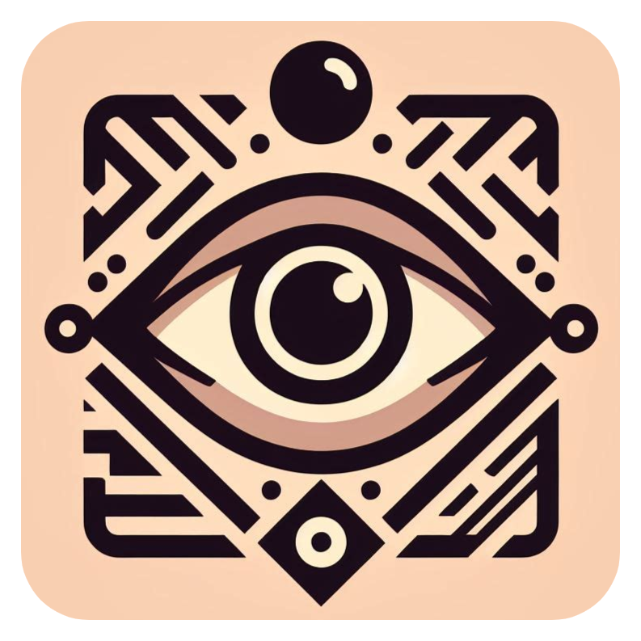
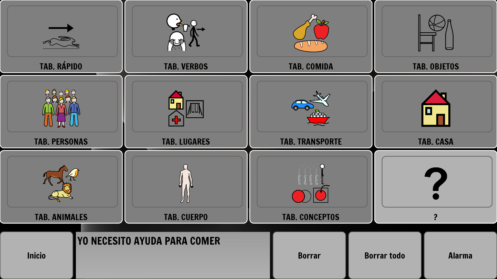

<div align="center">
  
  <h1>ComunicELA</h1>
  <p><strong>CAA basada en seguimiento de la mirada y tableros pictográficos.</strong></p>
  <p>
    
    
    
  </p>
</div>

## Descripción

ComunicELA es una aplicación de escritorio de comunicación aumentativa y alternativa (CAA) concebida para ofrecer una vía de interacción accesible a personas con dificultades motoras o del habla. A partir de una cámara convencional, transforma la dirección de la mirada y el parpadeo en acciones dentro de una interfaz visual basada en pictogramas.

El sistema combina visión por computador y un modelo de estimación de la mirada. El usuario puede navegar entre tableros, seleccionar conceptos, construir mensajes y reproducirlos mediante síntesis de voz. El modelo también puede reentrenarse para adaptarse a las características de cada persona.

La experiencia principal funciona de forma local y no depende de servicios externos. Como complemento opcional, ComunicELA puede utilizar Google Gemini para convertir las palabras seleccionadas en una frase conjugada y natural antes de enviarla al sintetizador de voz. Los tableros son personalizables, permitiendo ampliar o adaptar el vocabulario sin modificar el código de la aplicación.

La descripción completa del análisis, diseño, implementación y evaluación del sistema está disponible en la [memoria técnica de ComunicELA](ComunicELA.pdf).

<div align="center">
  
  <br>
  <sub>Tablero pictográfico para la composición y reproducción de mensajes.</sub>
</div>

## Funcionalidades principales

- Control de la interfaz mediante la mirada y el parpadeo.
- Calibración del parpadeo.
- Reentrenamiento del modelo para mejorar su adaptación al usuario.
- Construcción de frases a partir de pictogramas.
- Lectura de las frases mediante síntesis de voz de Windows.
- Tableros editables.
- Interfaz disponible en español y gallego.
- Corrección y conjugación opcional de frases con Google Gemini.

---

## Puesta en marcha

### Requisitos

- Windows 10 u 11.
- Python 3.10, 3.11 o 3.12.
- Cámara web.
- Una voz compatible con el sistema de síntesis de voz de Windows.
- Conexión a Internet y una clave de Gemini únicamente si se desea utilizar el conjugador automático.

### Instalación y ejecución

1. Crea y activa un entorno virtual desde PowerShell, en la carpeta del proyecto:

```powershell
python -m venv .venv
.\.venv\Scripts\Activate.ps1
```

2. Instala las dependencias:

```powershell
python -m pip install --upgrade pip
python -m pip install -r requirements.txt
```

3. Inicia la aplicación:

```powershell
python main.py
```

---

## Configuración opcional de Gemini

ComunicELA puede utilizar Google Gemini para convertir la secuencia de palabras seleccionada en una oración más natural antes de reproducirla. Esta integración es opcional: sin una clave API, el resto de la aplicación continúa funcionando con normalidad.

### Obtener una clave API

Genera una clave desde [Google AI Studio](https://aistudio.google.com/app/apikey).

### Configurar la clave en Windows

1. Abre el menú Inicio de Windows y busca **Variables de entorno**.
2. Selecciona **Editar las variables de entorno del sistema**.
3. Pulsa **Variables de entorno**.
4. En **Variables de usuario**, selecciona **Nueva**.
5. Introduce `GOOGLE_API_KEY` como nombre de la variable.
6. Introduce la clave API como valor y guarda los cambios.
7. Cierra y vuelve a abrir la aplicación.

---

## Personalización de tableros

Los tableros se definen mediante archivos `.xlsx`.

### Archivos disponibles

| Archivo | Idioma |
| --- | --- |
| `tableros/tableros_es_ES.xlsx` | Español |
| `tableros/tableros_gal_ES.xlsx` | Gallego |

Cada hoja del libro representa un tablero distinto. La primera pantalla que se muestra corresponde a la hoja `TAB. INICIAL`.

### Formato de las casillas

Cada casilla del tablero utiliza dos columnas consecutivas:

| Columna | Contenido |
| --- | --- |
| Primera | Nombre del archivo del pictograma. |
| Segunda | Palabra o mensaje mostrado en la interfaz. |

Los archivos de imagen compartidos por ambos idiomas se encuentran en `tableros/pictogramas`.

### Añadir o sustituir un pictograma

1. Copia la nueva imagen en `tableros/pictogramas`.
2. Abre el archivo del tablero que quieras modificar.
3. Escribe el nombre del archivo de imagen en la primera columna de la casilla.
4. Escribe el texto visible en la segunda columna.
5. Guarda el libro manteniendo el formato `.xlsx`.

### Enlaces entre tableros

Una casilla se interpreta como un enlace cuando su texto comienza por `TAB. `. El texto completo debe coincidir exactamente con el nombre de otra hoja del mismo libro. Por ejemplo, `TAB. RÁPIDO` abre la hoja denominada `TAB. RÁPIDO`.

> **Recomendación:** incluye en todas las hojas, excepto en `TAB. INICIAL`, una casilla para regresar al tablero inicial.

### Comprobaciones antes de guardar

- No cambies el nombre de `TAB. INICIAL`.
- Conserva las dos columnas asignadas a cada casilla.
- Comprueba que los nombres de las imágenes incluyan su extensión y coincidan exactamente con los pictogramas guardados.
- Mantén sincronizados los enlaces `TAB. ...` con los nombres de las hojas.


---

## Premios y Reconocimientos

- **Premio al Mejor TFG Aplicado** – Facultad de Informática, Universidade da Coruña (2025).  
- **Mención de Honor en los Premios CREAIMPACTO** – Uno de los tres mejores proyectos de España en la categoría Salud (2025).  
- **2º Premio al Mejor Trabajo de Fin de Grado** – Asociación Española para la Inteligencia Artificial (AEPIA) (2025).  
- **Premio al Mejor Trabajo de Fin de Estudios en Emprendimiento** – Categoría Ciencias de la Salud, Universidade da Coruña (2025).  
- **Premio ao Mellor Traballo Universitario con Licenza Libre** - GPUL, XVIII edición (2025).
- **Premio TalentPRO 2026** -  Categoría de Nuevas Tecnologías (2026)

---

## Difusión en medios
- [LinkedIn - Introducing ComunicELA](https://www.linkedin.com/posts/pabloparamotelle_introducing-comunicela-comunicela-activity-7253848414939955202-dNCy?utm_source=social_share_send&utm_medium=member_desktop_web&rcm=ACoAAByHYYkB_E_HDtRnYXUh-XtJ0k-h_0mzfnQ)
- [Fundación Universidade da Coruña - Carlota Vázquez e Pablo Páramo reciben o Décimo Premio ao mellor TFG aplicado 2023/24 durante a FepeFIC](https://www.fundacion.udc.es/noticia.asp?id=914&idioma=GA)
- [El Ideal Gallego - Un estudiante de la UDC, entre los tres mejores de España en los Premios CREAIMPACTO 2025](https://www.elidealgallego.com/articulo/a-coruna/estudiante-udc-entre-tres-mejores-espana-premios-creaimpacto-2025-5349103)  
- [El Ideal Gallego - Pablo Páramo | “La idea es que todos los pacientes con ELA puedan descargar el código, utilizarlo e incluso mejorarlo”](https://www.elidealgallego.com/articulo/a-coruna/pablo-paramo-idea-todos-pacientes-ela-puedan-descargar-codigo-utilizarlo-e-incluso-mejorarlo-5351524)  
- [UDC - Un estudante da UDC, entre os tres mellores de España nos Premios CREAIMPACTO 2025](https://www.udc.es/novas/Un-estudante-da-UDC-entre-os-tres-mellores-de-Espana-nos-Premios-CREAIMPACTO-2025/?fbclid=IwY2xjawLPagNleHRuA2FlbQIxMQABHmoErZkbHRHc8se3bh5jEwb2b_TUPh_Z2HtHwwYRcrfFSh6WLGRryYHJBKlq_aem_HIMF6ydyiBnKz8q-T7Z2Vw)  
- [Fundación UDC - Un estudiante de la UDC, entre los tres mejores de España en los Premios CREAIMPACTO 2025](https://www.fundacion.udc.es/site_noticia.asp?id=949&idioma=ES)
- [ABC - Un trabajo de fin de grado de la UDC sienta las bases para mejorar la comunicación de pacientes con ELA](https://www.abc.es/espana/galicia/trabajo-fin-grado-udc-sienta-bases-mejorar-20250701134827-nt.html?ref=https%3A%2F%2Fwww.google.com%2F)
- [El Español / Quincemil - Un estudiante de la Universidade da Coruña, entre los mejores de los Premios CREAIMPACTO](https://www.elespanol.com/quincemil/cultura/educacion/20250630/estudiante-universidade-da-coruna-mejores-premios-creaimpacto/1003743827602_0.html)  
- [La Opinión de A Coruña - Un alumno de la UDC, galardonado en Creaimpacto](https://www.laopinioncoruna.es/coruna/2025/06/30/alumno-udc-galardonado-creaimpacto-119226674.html)
- [Onda Cero - Podcast de Ciencia de Onda Cero en colaboración con la UDC](https://amp-ondacero-es.cdn.ampproject.org/c/s/amp.ondacero.es/emisoras/galicia/coruna/mas-de-uno/ciencia/udciencia-01072025_20250704686780d777c93072586743e6.html) 
- [Código Cero - Os Premios CreaImpacto recoñecen ao estudante Pablo Páramo (UDC) polo proxecto ComunicELA](https://codigocero.com/Os-Premios-CreaImpacto-reconecen-ao-estudante-Pablo-Paramo-UDC-polo-proxecto)  
- [CODDII - Un estudiante de Informática de la UDC, entre los tres mejores de España en los Premios CREAIMPACTO 2025](https://coddii.org/un-estudiante-de-informatica-la-udc-entre-los-tres-mejores-de-espana-en-los-premios-creaimpacto-2025)  
- [UDC - Acto de entrega dos Premios de Emprendemento da Universidade da Coruña no marco de UDC TALENTO](https://udc.es/gl/novas/Acto-de-entrega-dos-Premios-de-Emprendemento-da-Universidade-da-Coruna-no-marco-de-UDC-TALENTO/)
- [ABC - Los premios TalentPRO reconocen los cinco mejores trabajos universitarios de entre 500 propuestas de 65 universidades españolas](https://www.abc.es/sociedad/pulsera-detecta-crisis-epilepticas-scape-room-desinformacion-20260626141415-nt.html)
- [UDC - O Traballo de Fin de Grao do estudante da #UDC Pablo Páramo Telle sobre comunicación asistida en pacientes con #ELA foi recoñecido cunha mención de honra nos Premios CREAIMPACTO 2025](https://www.instagram.com/p/DLhhr-msgI6/?igsh=MWZjczkzODA3aDlzbQ==)
- [GPUL - XVIII edición do Premio ao TFG Libre](https://gpul.org/novas/2025/premio-tfg/)
- [ABC - Valeria González, Pablo Páramo, Marta Villegas, Manuel Alexander Fustamante y Leire Ochoaerrarte han sido galardonados en su tercera edición](https://www.abc.es/sociedad/premios-talentpro-vocento-u4impact-imagenes-20260626134511-ga.html)
- [UDC - O estudante da UDC Pablo Páramo Telle gaña o Premio TalentPRO 2026 na categoría de Novas Tecnoloxías](https://www.udc.gal/en/novas/O-estudante-da-UDC-Pablo-Paramo-Telle-gana-o-Premio-TalentPRO-2026-na-categoria-de-Novas-Tecnoloxias/)


---


## Licencias y atribuciones

### Código fuente

El código de ComunicELA se distribuye bajo la licencia [GNU General Public License v3.0](LICENSE).

### Propiedad intelectual

ComunicELA está inscrita como programa de ordenador con el asiento registral `03/2025/362`. Titular de los derechos de explotación: Universidade da Coruña.

### Pictogramas de ARASAAC

Autor: Sergio Palao · Procedencia: [ARASAAC](https://arasaac.org/) · Licencia: [CC BY-NC-SA 4.0](https://creativecommons.org/licenses/by-nc-sa/4.0/deed.es) · Titular: Gobierno de Aragón (España).
